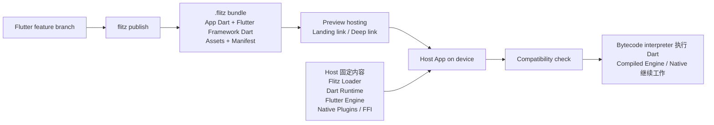

# Flitz ，一个把 Flutter 玩成热插拔 Preview 的有趣项目，不错的思路

Flitz 是  LeanCode 的一个新产品，他家的项目我们之前介绍过类似 Patrol 、Marionette 之类的，这次的这个 Flitz 也挺有意思的，类似 Android 和 iOS 版的 “Vercel Preview Deployment” 。

简单来说就是，在本地 Flutter 分支改完代码后，你不需要提 PR、不需要等 CI 或者发布，直接执行  `flitz publish`，它就会把这一版 Flutter 代码打成一个 `.flitz` bundle，上传后生成链接或者二维码，然后比如设计、产品、测试在手机上点开，就能直接运行这一个分支的版本，就是把「改完代码到真机效果」hotload 成几分钟。

Flitz  会把 App 拆成两部分：

- 手机里预先安装一个你打包好的 Host App ，里面包含你自己的 Flutter Engine、Dart Runtime 和需要的 Native Plugin
- 之后每次发布只传你的 Dart 代码、Flutter Framework Dart 部分和 assets，编译成 portable bytecode，别人打开链接后，Host 下载 bundle 就可以直接执行

> *所以性能不会很好，但是几乎支持整套 Flutter 生态加载，类似 3 分钟内产品就可以看到真机反馈。*

**比如之前 Flutter 场景的 Reload 很快 ，但是没分发能力，就你自己看到，现在 Flitz 把这个变成了带分发能力的  Hot Reload，核心是通过它们的容器 App 去实现**。

Host 还是一个正常签名的 Release App，团队可以通过 TestFlight、Google Play internal testing 或者 Firebase App Distribution 先装到评审设备上，之后只要 Native 侧没有变化，开发者每次执行  `flitz publish`  就都不需要重新生成和安装完整 App。

> 比如一个支付页分支只改了 Dart Widget、表单校验、文案和图片资源，开发者本地确认后直接 publish，CLI 编译完整 Dart 侧、带上 assets 上传，返回 landing page、deep link 和 bundle link，只要测试手机里已经存在 Host，点开链接后 Loader 下载 bundle 就可以直接看到真实 Flutter 效果。

其实我理解就是，**它在 Dart VM 里搞了一套  Dart VM 的 bytecode interpreter 来说这个**，所以性能肯定不考虑，但是实际渲染和功能调用不受影响，还是原本的路径，感觉应该类似 Shorebird 的路线。

不过目前这个产品还是 Early Access，支持 Flutter 3.41+，发布 Bundle 的机器目前只能是 Linux x64 或者 Apple Silicon Mac，运行端要求 Android API 29+ 或 iOS 16+，iOS Loader 暂不支持 Simulator，但是最重要的是这是一个收费项目，还是有些可惜···

**这么好的产品能力，居然是收费的，而且没开源**，但是这个方向确实有点意思，对于需要高频验收的产品来说，这确实是一个不错的思路。

## 链接

https://flitz.dev/
